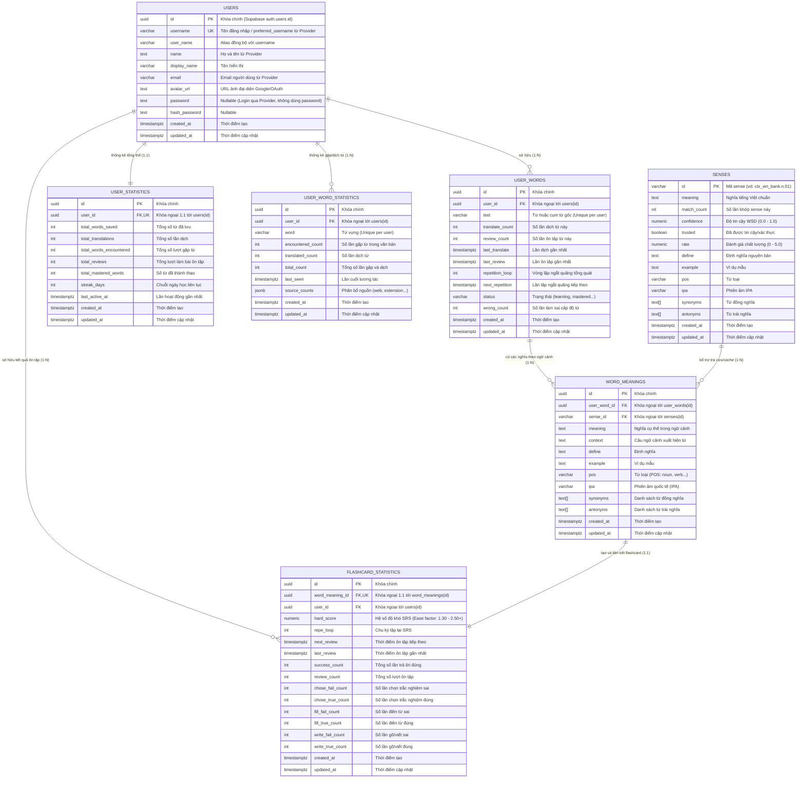

# Thiết Kế Cơ Sở Dữ Liệu Supabase (Database ERD & Architecture)

## 1. Sơ đồ Quan hệ Thực thể (Mermaid ERD)

---

## 2. Các điểm kỹ thuật nổi bật

1. **Quan hệ phân cấp từ vựng & ngữ cảnh:**
   - Mỗi người dùng (`users`) sở hữu danh sách các từ vựng duy nhất (`user_words` với constraint `UNIQUE(user_id, text)`).
   - Mỗi từ có thể mang nhiều tầng nghĩa khác nhau trong các bài đọc/ngữ cảnh khác nhau (`word_meanings`).
   - Mỗi tầng nghĩa sinh ra một thực thể flashcard riêng biệt (`flashcard_statistics` với quan hệ 1:1), tự động được khởi tạo thông qua **Database Trigger** `trg_auto_create_flashcard_stat`.

2. **Cơ chế tái sử dụng tri thức (Sense Cache):**
   - Bảng `senses` đóng vai trò là Global Knowledge Base / Shared Cache cho mô hình WSD (Word Sense Disambiguation).
   - Khi bất kỳ người dùng nào dịch một từ và hệ thống nhận diện được `sense_id`, hàm `upsert_sense_cache()` sẽ lưu lại hoặc tăng `match_count`, cho phép tái sử dụng định nghĩa, ví dụ, từ đồng nghĩa và phiên âm cho toàn bộ hệ thống.

3. **Thống kê chuyên sâu phục vụ thuật toán Spaced Repetition (SRS):**
   - Bảng `flashcard_statistics` ghi nhận chi tiết tỉ lệ đúng/sai theo từng thể loại bài tập:
     - `chose_fail_count` / `chose_true_count` (Trắc nghiệm Multiple Choice)
     - `fill_fail_count` / `fill_true_count` (Điền từ vào chỗ trống Fill-in-the-blank)
     - `write_fail_count` / `write_true_count` (Gõ/chính tả Spelling & Dictation)
   - Lưu trữ hệ số độ khó `hard_score` (tương thích thuật toán SM-2) và vòng lặp `repe_loop` cùng thời gian ôn tập tiếp theo `next_review`.

4. **Thống kê hành vi đọc & dịch (`user_word_statistics`):**
   - Đáp ứng chính xác yêu cầu đếm số lần gặp từ (`encountered_count`) và số lần dịch từ (`translated_count`).
   - Hỗ trợ lưu trữ dạng JSONB `source_counts` để phân biệt lượt tra từ Extension hay Web.
